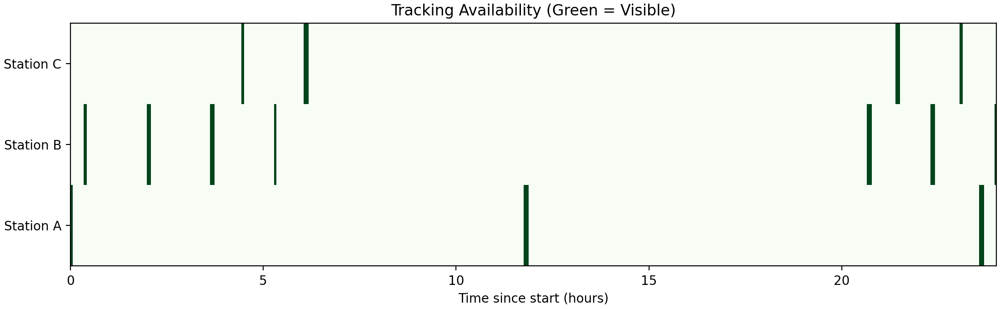
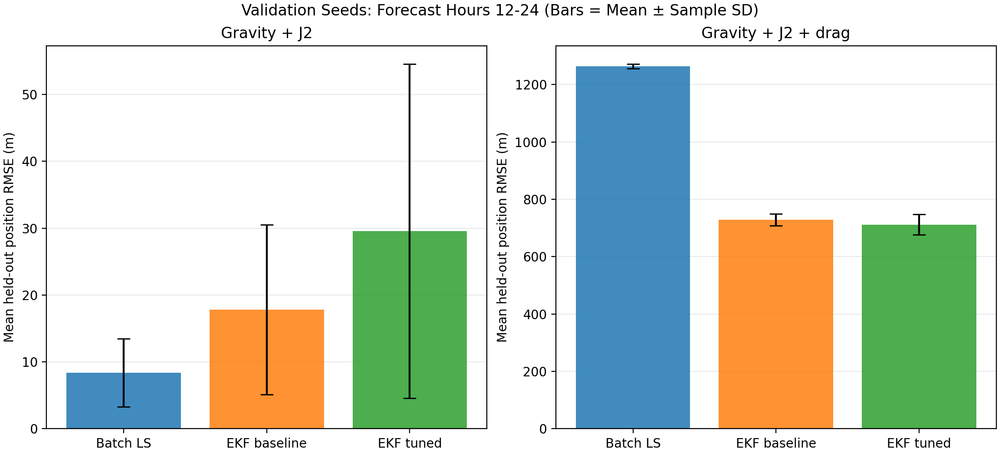
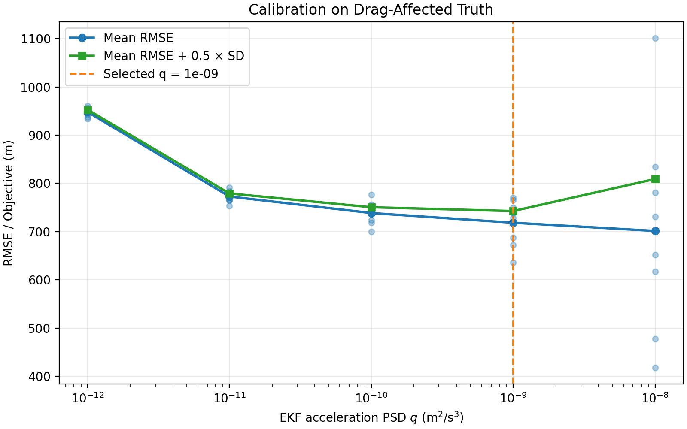

# Satellite orbit determination with batch least squares and an EKF

This project compares two methods for estimating a satellite's orbit from intermittent ground-station measurements. The main question is how well each method handles a small but persistent force that is missing from the estimation model.

The simulator follows a low-Earth-orbit satellite for 24 hours. Three ground stations measure its range and range rate whenever it is above their elevation masks. The first 12 hours of observations are used to estimate the orbit; both methods then predict the next 12 hours without new measurements.

There are two versions of the simulated orbit: gravity with J2, and gravity with J2 plus atmospheric drag. **Both estimators always use the gravity + J2 model.** This makes it possible to separate errors from noisy observations from errors caused by missing physics.

## Simulation

The satellite state is six-dimensional: three Cartesian position components and three velocity components in an Earth-centered inertial (ECI) frame.

```math
\mathbf{x}=\begin{bmatrix}\mathbf{r}\\\mathbf{v}\end{bmatrix},
\qquad
\dot{\mathbf r}=\mathbf v,\qquad
\dot{\mathbf v}=\mathbf a_{\mathrm{gravity}}+\mathbf a_{J_2}+\mathbf a_{\mathrm{drag}}.
```

The gravitational acceleration is the usual two-body term,

```math
\mathbf a_{\mathrm{gravity}}=-\frac{\mu}{r^3}\mathbf r,
```

plus the J2 correction for Earth's oblateness:

```math
\mathbf a_{J_2}=\frac{3J_2\mu R_E^2}{2r^5}
\begin{bmatrix}
x(5z^2/r^2-1)\\
y(5z^2/r^2-1)\\
z(5z^2/r^2-3)
\end{bmatrix}.
```

The drag experiments add

```math
\mathbf a_{\mathrm{drag}}
=-\frac12\rho(h)C_D\frac{A}{m}
\lVert\mathbf v_{\mathrm{rel}}\rVert\mathbf v_{\mathrm{rel}},
\qquad
\mathbf v_{\mathrm{rel}}=\mathbf v-\boldsymbol\omega_E\times\mathbf r.
```

The atmosphere co-rotates with Earth, and its density follows a simple exponential profile, with a reference density of $7\times10^{-13}\,\mathrm{kg/m^3}$ at 500 km and a scale height of 65 km. The drag parameters are $C_D=2.2$, cross-sectional area $0.2\,\mathrm{m^2}$, and mass $20\,\mathrm{kg}$. Altitude is measured relative to the WGS84 ellipsoid. The purpose is to introduce a plausible missing force, not to reproduce a particular satellite or atmospheric conditions.

The initial orbit is approximately circular at 500 km altitude and 55° inclination. Three hypothetical stations are located at different latitudes and longitudes. Earth rotates at a constant rate; each station measures only when the satellite is at least 10° above its horizon. Measurements are attempted every 30 seconds, with independent Gaussian errors of 10 m in range and 0.1 m/s in range rate.



## Orbit estimation

**Batch least squares** fits one initial position and velocity to all the available observations. The unknowns are the six initial-state components, not the gravitational constants. The objective is a sum of squared range and range-rate residuals, normalized by their measurement uncertainties:

```math
\hat{\mathbf x}_0=\mathop{\mathrm{argmin}}_{\mathbf x_0}
\sum_k\left\|R_k^{-1/2}\left(\mathbf y_k-h_k[\Phi(t_k;\mathbf x_0)]\right)\right\|^2.
```

Here $\Phi$ is numerical orbit propagation and $h_k$ is the measurement model for the station observing at time $t_k$. The implementation uses SciPy's nonlinear `least_squares` solver and a finite-difference Jacobian.

The **Extended Kalman Filter** (EKF) instead works sequentially. It propagates the estimated state and its covariance between observations, then corrects both when a station reports a measurement. The covariance propagation uses

```math
\dot P=AP+PA^T+Q_c,
\qquad A=\frac{\partial f}{\partial\mathbf x},
\qquad Q_c=\begin{bmatrix}0&0\\0&qI_3\end{bmatrix}.
```

$q$ is the acceleration process-noise power spectral density, in $\mathrm{m^2/s^3}$. It controls how quickly the filter allows uncertainty from unmodeled accelerations to accumulate. The measurement update uses the nonlinear range/range-rate model, its Jacobian, and Joseph-form covariance updating.

The EKF does not know the atmospheric drag equation. Increasing $q$ can make it more willing to correct a bad prediction when a station becomes visible, but it also makes the estimate more sensitive to measurement noise. During the 12-hour period without observations, changing $q$ affects the propagated covariance but does not directly add drag to the predicted trajectory.

## Experiments and results

The initial comparison runs one tracking simulation with and without drag. The figure below shows the position errors during the held-out forecast. With the dynamics matched, both methods remain within a few meters; with drag missing, the errors grow over the forecast interval.


One simulation can be misleading if its measurement noise happens to be favorable. A Monte Carlo experiment addresses this by holding the true orbit and station geometry fixed while varying measurement noise across random seeds.

Eight calibration seeds were used to tune the EKF process noise against the drag-affected trajectory. The candidates were $10^{-12},10^{-11},10^{-10},10^{-9},10^{-8}\,\mathrm{m^2/s^3}$. The selection criterion includes both mean RMSE and its sample standard deviation:

```math
J(q)=\overline{\mathrm{RMSE}}(q)+0.5\,s_{\mathrm{RMSE}}(q).
```

This penalizes settings whose performance varies substantially with the noise realization. The selected value was $q=10^{-9}\,\mathrm{m^2/s^3}$; the original EKF setting was $10^{-10}\,\mathrm{m^2/s^3}$.

All three estimator configurations were then evaluated on 12 new seeds (not used to select $q$), under both true dynamics models. The table reports the mean and sample standard deviation of position RMSE across those trials. RMSE is calculated over the entire 12–24 hour forecast, on a five-minute grid.

| True dynamics | Estimator | Forecast position RMSE (m) |
| --- | --- | ---: |
| Gravity + J2 | Batch least squares | 8.36 ± 5.08 |
| Gravity + J2 | EKF, $q=10^{-10}$ | 17.81 ± 12.72 |
| Gravity + J2 | EKF, $q=10^{-9}$ | 29.58 ± 24.99 |
| Gravity + J2 + drag | Batch least squares | 1,264.44 ± 7.76 |
| Gravity + J2 + drag | EKF, $q=10^{-10}$ | 728.29 ± 20.60 |
| Gravity + J2 + drag | EKF, $q=10^{-9}$ | 712.02 ± 36.17 |



With the correct dynamics, batch least squares performs best. When drag is present but unmodeled, the tuned EKF has **43.7% lower mean forecast position RMSE** than batch least squares. The EKF can adjust its state when new observations arrive, whereas the batch fit must explain the entire observation period using one initial condition and an incomplete dynamics model.

The process-noise tuning had a smaller effect. Raising $q$ from $10^{-10}$ to $10^{-9}$ improved the mean drag-case forecast from 728 m to 712 m, but increased its trial-to-trial standard deviation. It also made the no-drag results worse. There is no single setting that performs best in both scenarios.



Position NEES at 24 hours provides a check of whether the EKF's covariance agrees with its actual errors:

```math
\mathrm{NEES}_r=(\hat{\mathbf r}-\mathbf r)^T
P_{rr}^{-1}(\hat{\mathbf r}-\mathbf r).
```

For a calibrated three-dimensional Gaussian position estimate, the expected NEES is 3. Under unmodeled drag, the mean NEES was 70.6 for the original EKF and 7.3 after tuning. Increasing $q$ helped with overconfidence, although the tuned covariance was still not perfectly calibrated. With matched dynamics, both versions were conservative (mean NEES 0.9 and 0.3, respectively).

## Running the code

The project uses Python 3.11 with NumPy, SciPy, Matplotlib, pandas, and pytest. From the project root:

```bash
python -m pip install numpy scipy matplotlib pandas pytest
python -m pytest -q
```

Each experiment can be run independently:

```bash
python -m experiments.tracking_demo
python -m experiments.baseline_estimation
python -m experiments.ekf_estimation
python -m experiments.drag_comparison
python -m experiments.monte_carlo
```

There is also a shorter Monte Carlo check:

```bash
python -m experiments.monte_carlo --quick
```

The full experiment writes plots to `results/figures/` and CSV files to `results/raw/`. The Monte Carlo CSVs contain the calibration runs, individual validation trials, and summary statistics. Rerunning the full experiment replaces files with the same names; the quick check uses `results/quick_check/`.

The main pieces of the repository are:

- `src/dynamics.py`, `src/propagation.py`, `src/drag.py` — orbital dynamics and integration.
- `src/ground_stations.py`, `src/measurements.py`, `src/simulation.py` — visibility and synthetic observations.
- `src/batch_estimator.py`, `src/ekf.py` — the two estimation methods.
- `experiments/` — scripts for the comparisons and plots.
- `tests/` — tests of dynamics, measurements, and estimators.

## Limitations

The experiment uses simulated measurements and a deliberately simple atmosphere. It omits measurement biases, outliers, light-time effects, atmospheric propagation delays, Earth-orientation corrections, maneuvers, and other orbital perturbations. The six-dimensional state contains position and velocity only; attitude is not modeled.

The Monte Carlo trials vary measurement noise, **not** the orbit, drag parameters, station locations, or initial-state error. Also, the process-noise parameter is calibrated using known simulated truth; a real system would need another way to assess model error. With eight calibration seeds and 12 validation seeds, the numbers are useful for comparing these particular configurations, but not for establishing a universally optimal $q$.
