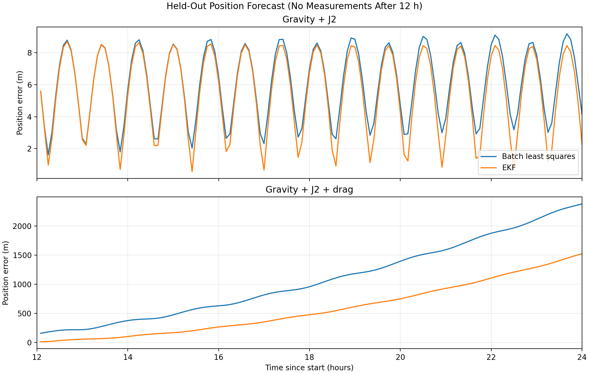

# Satellite Orbit Determination Under Model Uncertainty

**Python simulation and estimation of a low-Earth-orbit (LEO) satellite using batch nonlinear least squares and an Extended Kalman Filter (EKF).**

The project investigates a practical orbit-determination problem: **what happens when a state estimator uses an incomplete model of the satellite's motion?** A synthetic satellite is propagated under Earth's gravity, the J2 oblateness perturbation, and optionally atmospheric drag. Three rotating ground stations provide intermittent, noisy range and range-rate observations. Both estimators assume gravity + J2, so atmospheric drag is an *unmodeled perturbation* in the harder experiment.

The evaluation emphasizes 12-hour forecasts **after tracking measurements stop**, not just the accuracy immediately after a ground-station update. A Monte Carlo study compares accuracy, variability across measurement-noise realizations, and the EKF's covariance consistency.

## Key findings

- With **correct dynamics**, batch least squares produced the lowest mean 12-hour forecast position RMSE: **8.36 m** versus **17.81 m** for the baseline EKF.
- With **unmodeled drag**, the EKF was more accurate: **728.29 m** mean position RMSE versus **1,264.44 m** for batch least squares, a **42.4% reduction**.
- Tuning EKF process noise to penalize both average error and trial-to-trial variability selected **$q=10^{-9}\,\mathrm{m^2/s^3}$**. In the drag case, its forecast RMSE was **712.02 ± 36.17 m** across 12 validation noise realizations.
- A covariance-consistency check exposed the limitations of ignoring drag: baseline EKF mean position NEES at 24 hours was **70.6**, compared with the ideal expectation of **3** for a correctly calibrated three-dimensional position estimate.

These are results from **synthetic data**, not flight measurements. In the Monte Carlo study, the orbit and physical parameters remain fixed; independent measurement-noise draws are varied.

## Results at a glance

The two plots below show how model mismatch affects forecasting and why the process-noise choice matters.



*Single-seed example. Gray 12–24 h forecast interval contains no estimator measurement updates. Both methods propagate gravity + J2, even when the truth includes drag.*


*Independent validation seeds; bars are mean 12–24 h forecast position RMSE with sample-standard-deviation error bars.*


*Calibration uses only drag-affected simulations and eight measurement-noise seeds. The green curve includes a penalty for trial-to-trial variability.*

## Model and measurement setup

### Satellite dynamics

The six-component Earth-centered inertial (ECI) state is

$$
\mathbf{x}=\begin{bmatrix}\mathbf{r}\\\mathbf{v}\end{bmatrix},
\qquad
\dot{\mathbf{x}}=\begin{bmatrix}\mathbf{v}\\\mathbf{a}(\mathbf{r},\mathbf{v})\end{bmatrix}.
$$

The estimator's acceleration model is two-body gravity plus Earth's J2 perturbation:

$$
\mathbf{a}_{\mathrm{grav}}=-\frac{\mu}{r^3}\mathbf{r},
$$

$$
\mathbf{a}_{J_2}=
\frac{3J_2\mu R_E^2}{2r^5}
\begin{bmatrix}
x(5z^2/r^2-1)\\
y(5z^2/r^2-1)\\
z(5z^2/r^2-3)
\end{bmatrix}.
$$

The optional drag **truth** model adds

$$
\mathbf{a}_{\mathrm{drag}}=
-\tfrac12\rho(h)C_D\frac{A}{m}
\lVert\mathbf{v}_{\mathrm{rel}}\rVert\mathbf{v}_{\mathrm{rel}},
\qquad
\mathbf{v}_{\mathrm{rel}}=\mathbf{v}-\boldsymbol\omega_E\times\mathbf r,
$$

with a simplified exponential atmosphere,

$$
\rho(h)=\rho_{\mathrm{ref}}
\exp\left(-\frac{h-h_{\mathrm{ref}}}{H}\right).
$$

Altitude for the density model is evaluated relative to the WGS84 ellipsoid. This is an illustrative co-rotating atmosphere, **not** a high-fidelity thermosphere or space-weather model.

| Simulation setting | Value |
| --- | --- |
| Nominal initial orbit | Approximately circular, 500 km altitude, 55° inclination |
| Simulation horizon | 24 hours |
| Measurement attempts | Every 30 seconds, only while a station has visibility |
| Stations | Three geographically separated, hypothetical Earth-fixed stations |
| Minimum station elevation | 10° |
| Range measurement noise | Independent Gaussian, $\sigma_\rho=10$ m |
| Range-rate measurement noise | Independent Gaussian, $\sigma_{\dot\rho}=0.1$ m/s |
| Drag parameters | $C_D=2.2$, area $0.2\,\mathrm{m^2}$, mass $20\,\mathrm{kg}$ |
| Atmosphere parameters | $\rho_{\mathrm{ref}}=7\times10^{-13}\,\mathrm{kg/m^3}$ at 500 km; scale height 65 km |

Station positions and velocities rotate with Earth. A measurement is produced only if the satellite is above the station's elevation mask. For station position $\mathbf r_s$ and velocity $\mathbf v_s$, the modeled observations are

$$
\rho=\lVert\mathbf r-\mathbf r_s\rVert,
\qquad
\dot\rho=\frac{(\mathbf r-\mathbf r_s)\cdot(\mathbf v-\mathbf v_s)}{\rho}.
$$

This creates realistic **gaps in tracking coverage**. Visibility and measurement timing are shown in [`tracking_visibility.png`](results/figures/tracking_visibility.png) and [`tracking_measurements.png`](results/figures/tracking_measurements.png).

### Batch nonlinear least squares

Batch estimation fits **only the six Cartesian components of the initial state**, treating physical constants as known. With state transition by numerical integration $\Phi(t;\mathbf x_0)$, it minimizes the sum of squared noise-normalized measurement residuals:

$$
\hat{\mathbf x}_0=
\underset{\mathbf x_0}{\operatorname{argmin}}
\sum_k\left\lVert
R_k^{-1/2}\left[\mathbf y_k-h_k\left(\Phi(t_k;\mathbf x_0)\right)\right]
\right\rVert^2.
$$

The implementation uses `scipy.optimize.least_squares`, scaled optimization variables, and a central finite-difference Jacobian. Once the initial state is fitted using observations through hour 12, it is propagated without additional corrections to hour 24.

### Extended Kalman Filter

The EKF estimates the same six-dimensional state **sequentially**. Between measurements it propagates the nonlinear orbital dynamics and the $6\times6$ state covariance:

$$
\dot{P}=AP+PA^T+Q_c,
\qquad
A=\frac{\partial f}{\partial\mathbf x},
\qquad
Q_c=\begin{bmatrix}0&0\\0&qI_3\end{bmatrix}.
$$

Here $q$ is the continuous-time **white-acceleration process-noise power spectral density**, with units $\mathrm{m^2/s^3}$. It represents uncertainty from accelerations the filter has not modeled explicitly; it does **not** add a deterministic drag force to the EKF trajectory.

At each available observation, the EKF computes an innovation and measurement Jacobian $H$, then updates with

$$
K=PH^T(HPH^T+R)^{-1},
\qquad
\hat{\mathbf x}^{+}=\hat{\mathbf x}^{-}+K(\mathbf y-h(\hat{\mathbf x}^{-})).
$$

The covariance update uses the **Joseph form** to improve numerical symmetry and stability. No measurements are provided after hour 12; thereafter, both estimators forecast using gravity + J2 only.

## Experimental design

### Baseline comparison: matched versus mismatched dynamics

Two separate truth trajectories are simulated:

1. **Gravity + J2** — the estimators' physical model matches the truth.
2. **Gravity + J2 + atmospheric drag** — the estimators both omit a real force.

Both methods share the same deliberately imperfect initial guess and the same noisy observations for a given scenario and seed. Only measurements from hours **0–12** are used to estimate the state. Hours **12–24** are a held-out *forecast interval*: there are no updates, even during potential ground-station passes.

### Monte Carlo process-noise calibration and validation

The Monte Carlo experiment changes only the independently sampled range/range-rate errors, keeping the true trajectory and ground-station geometry fixed. True states are used **only to calculate simulation metrics and select a PSD on calibration trials**, never as observations supplied to either estimator.

- **Calibration:** eight seeds (`100`–`107`), drag-affected truth only, across $q\in\{10^{-12},10^{-11},10^{-10},10^{-9},10^{-8}\}\,\mathrm{m^2/s^3}$.
- **Selection objective:** minimize the mean forecast position RMSE plus half its **sample standard deviation**:

  $$
  J(q)=\overline{\operatorname{RMSE}}(q)+0.5\,s_{\operatorname{RMSE}}(q).
  $$

- **Validation:** 12 disjoint seeds (`1000`–`1011`) under **both** truth models. Each trial compares batch least squares, the baseline EKF ($q=10^{-10}$), and the tuned EKF ($q=10^{-9}$).
- **Metrics:** 12–24 h position/velocity RMSE on a five-minute forecast grid; position NEES at 24 h for the EKFs.

Calibrating with simulation ground truth is a controlled experimental method; it is **not** a deployable in-flight method for selecting process noise from unknown truth. The final validation seeds are kept separate from the calibration seeds.

## Monte Carlo validation results

Results below are **mean ± sample standard deviation across 12 validation noise realizations**. RMSE is the root-mean-square Euclidean position error over the entire 12–24 h forecast interval, not the error at just one instant.

| Truth model | Estimator | Forecast position RMSE (m) |
| --- | --- | ---: |
| Gravity + J2 | Batch least squares | **8.36 ± 5.08** |
| Gravity + J2 | Baseline EKF, $q=10^{-10}$ | 17.81 ± 12.72 |
| Gravity + J2 | Tuned EKF, $q=10^{-9}$ | 29.58 ± 24.99 |
| Gravity + J2 + drag | Batch least squares | 1,264.44 ± 7.76 |
| Gravity + J2 + drag | Baseline EKF, $q=10^{-10}$ | 728.29 ± 20.60 |
| Gravity + J2 + drag | Tuned EKF, $q=10^{-9}$ | **712.02 ± 36.17** |

**Interpretation:** With correctly specified dynamics, the batch estimator benefits from enforcing a consistent trajectory over all fitted observations. With drag omitted, the EKF's sequential measurement corrections produce a much better state for the subsequent forecast. Increasing process noise further improves average drag-case accuracy slightly, but sacrifices some nominal-case accuracy and increases variability. No single configuration dominates both regimes.

### Covariance consistency: NEES

The EKF's normalized estimation error squared for the **three-dimensional position** at 24 hours is

$$
\operatorname{NEES}_{r}=
(\hat{\mathbf r}-\mathbf r)^TP_{rr}^{-1}(\hat{\mathbf r}-\mathbf r).
$$

For an unbiased Gaussian error distribution with correctly specified covariance, its expected value is **3**. Large NEES indicates error underestimated by the filter's covariance (overconfidence); small NEES indicates the opposite. This diagnostic does not measure accuracy by itself.

| Truth model | Baseline EKF mean position NEES | Tuned EKF mean position NEES |
| --- | ---: | ---: |
| Gravity + J2 | 0.9 | 0.3 |
| Gravity + J2 + drag | **70.6** | **7.3** |

The large baseline NEES under drag illustrates the risk of trusting covariance predictions from an incomplete dynamics model. Larger $q$ greatly reduces this overconfidence, but the tuned filter is **not perfectly calibrated**, and the nominal-model case becomes more conservative. These are descriptive averages over only 12 validation seeds, not a formal coverage guarantee.

## Reproduce the experiments

Run all commands **from the project root**. Python 3.11 or newer is recommended.

Install dependencies:

```bash
python -m pip install numpy scipy matplotlib pandas pytest
```

Run unit tests:

```bash
python -m pytest -q
```

Run individual studies:

```bash
python -m experiments.tracking_demo
python -m experiments.baseline_estimation
python -m experiments.ekf_estimation
python -m experiments.drag_comparison
python -m experiments.monte_carlo
```

To check the Monte Carlo pipeline with fewer seeds before running the full study:

```bash
python -m experiments.monte_carlo --quick
```

The quick check writes to `results/quick_check/`; the full run writes detailed tables to `results/raw/` and figures to `results/figures/`. Running the full experiment again **replaces the Monte Carlo outputs with the same filenames**. Seeds and PSD candidates are defined in `experiments/monte_carlo.py`, and the variability weight is controlled by `VARIABILITY_WEIGHT`.

Generated data files include:

- `results/raw/monte_carlo_calibration.csv` — each seed/PSD calibration result.
- `results/raw/monte_carlo_validation.csv` — per-seed performance for each estimator and truth model.
- `results/raw/monte_carlo_summary.csv` — validation means and sample standard deviations.

## Project organization

```text
src/
  constants.py          Earth and model constants
  dynamics.py           Two-body gravity and J2 perturbation
  propagation.py        Numerical integration of the orbital state
  ground_stations.py    Rotating station geometry and visibility
  measurements.py       Range/range-rate measurement model
  simulation.py         Synthetic tracking-data generation
  batch_estimator.py    Nonlinear batch initial-state estimation
  ekf.py                Continuous-discrete Extended Kalman Filter
  drag.py               Optional drag truth model

experiments/
  tracking_demo.py      Ground-station visibility and measurements
  baseline_estimation.py
  ekf_estimation.py
  drag_comparison.py    Single-seed matched/mismatched-dynamics comparison
  monte_carlo.py        Process-noise calibration and held-out validation

tests/                  Unit tests for physics, measurements and estimators
results/
  figures/              Generated visualizations
  raw/                  Generated CSV results
```

## Assumptions and limitations

- **Synthetic observations only.** No real ground-station data, timing errors, hardware biases, atmospheric propagation delay, or measurement outliers are included.
- **Simplified orbital environment.** The gravity model includes two-body and J2 terms. Drag uses a fixed exponential density profile and co-rotating atmosphere; solar and geomagnetic activity, winds, maneuvers, and other perturbations are omitted.
- **Simplified Earth and station timing.** Station geometry uses an idealized constant Earth rotation rate and a common arbitrary starting epoch, not a dated high-precision terrestrial-to-inertial transformation.
- **Fixed Monte Carlo truth.** The random trials vary measurement noise, not orbital elements, station placements, atmospheric parameters, satellite mass/area, or initial-guess error. Results should not be generalized to all LEO conditions.
- **Estimator model mismatch is intentional.** Both estimators are limited to gravity + J2 even when drag is present in truth. Increasing EKF process noise represents uncertainty; it does not explicitly infer or remove drag.
- **Limited calibration claims.** Eight calibration and 12 validation seeds provide a reproducible comparison, not a proof of optimal $q$ or statistical significance. The selected value depends on the tested PSD grid and the chosen accuracy–variability objective.
- **Translational state only.** The six modeled variables are three positions and three velocities; this is **not** a six-degree-of-freedom attitude-and-orbit simulation.

## Takeaway

This project illustrates two complementary approaches to nonlinear orbit determination and the value of evaluating estimators under **incorrect dynamics**, not just under an ideal matched model. Batch least squares performs well when the assumed physical model is accurate; sequential EKF measurement updates are more tolerant of omitted drag during the observation interval. Process-noise tuning reveals a second engineering tradeoff: a filter can achieve lower average error while producing less reliable forecasts or misleading covariance estimates.
